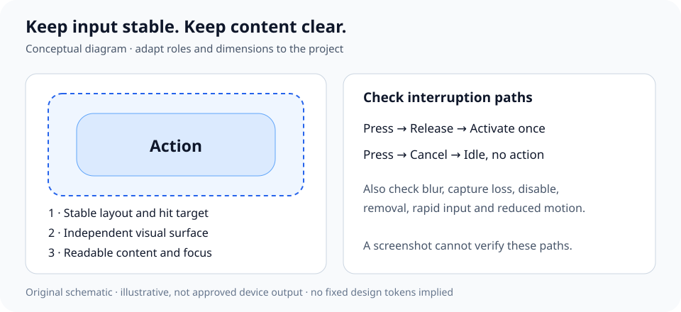

<div align="center">

# Visual & Interaction Design

### Keep the project's identity. Fix the parts that need it.

A modular Agent Skill for UI consistency, focused interaction fixes, and gradual design improvement.

**English** · [简体中文](./README.zh-CN.md)

[](./CHANGELOG.md)
[](./LICENSE)
[](https://github.com/Freedom-Wind441/design-visual-interaction/actions/workflows/validate.yml)

[Quick start](#quick-start) · [Modules](#modules) · [Related skills](#relationship-to-other-skills) · [Validation](./VALIDATION.md)

**[Browse the Skill](./skills/design-visual-interaction/)** · [Read the rules](./skills/design-visual-interaction/SKILL.md)

</div>

---

## Quick start

In Codex with `$skill-installer`, ask:

```text
$skill-installer install https://github.com/Freedom-Wind441/design-visual-interaction/tree/v0.3.1/skills/design-visual-interaction
```

Pin **v0.3.1** for reproducible use. `main` is the development branch; upgrade deliberately after reviewing the changelog.

Then describe the outcome in ordinary language:

```text
Use $design-visual-interaction to improve only this button's press feedback.
Preserve the current theme, action behavior and settings. Check shared
consumers and verify the result.
```

The agent selects the necessary modules. You do not need to learn the file structure.

<details>
<summary>Manual installation and version selection</summary>

Copy the entire [`skills/design-visual-interaction/`](./skills/design-visual-interaction/) folder into your host's documented skill location. For Codex, project and user locations are `.agents/skills/design-visual-interaction/` and `~/.agents/skills/design-visual-interaction/`.

Keep `SKILL.md`, `agents/`, `references/`, `assets/` and `LICENSE` together. Other hosts may use different locations. Use a published tag or an exact commit for reproducible installs. The quick-start URL pins this release.

</details>

No runtime scripts, API keys, fixed MCP service, or package dependencies are required by the Skill. The agent still needs the project's source, build tools and appropriate rendering/input access to implement and verify changes.

## What it does

| Situation | Approach |
| --- | --- |
| New project | Establish a small design baseline; implement and verify one representative flow first. |
| Growing project | Trace inconsistencies to actual components, tokens, events or platform limits; migrate gradually. |
| Mature project | Preserve proven decisions; fix evidenced defects; a no-change result is valid. |
| One-component request | Read only the relevant modules and necessary dependencies; check shared consumers. |
| Audit or plan only | Explain findings or a plan without changing the project. |

The default goal is consistency **within** a product. This is not a UI library, automatic reskin, universal redesign, or guarantee of better results on every project.

This release incorporates a source-reviewed comparison of six existing design-skill projects. See [the comparison and adoption record](./docs/comparison.md) / [中文](./docs/comparison.zh-CN.md). It does not claim to invent this category or replace those larger toolchains.

## Modules

The entrypoint supplies shared rules and routing. Detailed references load on demand; “related” does not mean “load everything.”

| Module | Focus |
| --- | --- |
| [Project baseline](./skills/design-visual-interaction/references/project-baseline.md) | Product constraints, existing tokens, approved versus experimental decisions |
| [Composition and visual hierarchy](./skills/design-visual-interaction/references/visual-composition.md) | Task focus, grouping, density, deliberate direction and design critique |
| [Platform adaptation](./skills/design-visual-interaction/references/platform-adaptation.md) | Actual rendering stack, platform units, semantics and suitable validation |
| [Dock and navigation](./skills/design-visual-interaction/references/dock-navigation.md) | Selection state, history, gestures and safe areas |
| [Buttons](./skills/design-visual-interaction/references/buttons.md) | Semantic roles, hit targets, cancellation and activation |
| [Typography and layout](./skills/design-visual-interaction/references/typography-layout.md) | Hierarchy, font fallback, localization and scaling |
| [Sliders and input](./skills/design-visual-interaction/references/sliders-input.md) | Range mapping, preview/commit, gestures and persistence |
| [Settings and onboarding](./skills/design-visual-interaction/references/settings-onboarding.md) | Entry points, dependent options and capability-aware presentation |
| [Motion and feedback](./skills/design-visual-interaction/references/motion-feedback.md) | Interruptible transitions, cleanup and reduced motion |
| [Color and materials](./skills/design-visual-interaction/references/materials-color.md) | Semantic colors, contrast, compositing and fallbacks |
| [Optional experiment: liquid glass](./skills/design-visual-interaction/references/style-liquid-glass.md) | Clear content layers, constrained distortion and performance limits |
| [Public worked cases](./skills/design-visual-interaction/references/worked-examples.md) | Compact historical patterns, source links and evidence boundaries |
| [Verification](./skills/design-visual-interaction/references/verification.md) | Evidence appropriate to the actual change and environment |



This original schematic explains a principle. It is not an approved product screenshot, measured visual result, or fixed style preset.

## Relationship to other skills

This is a **visual and interaction companion extension** to [Software Architecture](https://github.com/Freedom-Wind441/design-software-architecture), maintained in a separate repository. It works independently and has no mandatory skill dependency.

| Skill | Responsibility | Ownership |
| --- | --- | --- |
| **Visual & Interaction Design** | Experience targets, component rules, visual consistency and UI acceptance | Freedom-Wind441; this repository |
| **[Software Architecture](https://github.com/Freedom-Wind441/design-software-architecture)** | Responsibility boundaries, state ownership, reuse and necessary migration | Freedom-Wind441; separate repository |
| **[Reasoning Workflow](https://github.com/zy839971925-zyy/Agent--deep-research-Workflow-Skills)** | General reasoning, evidence and execution control | Independent third party: zy839971925-zyy |

Use the architecture companion when a structural problem prevents a reliable UI fix. Do not refactor a mature architecture for a local parameter adjustment. Use Reasoning Workflow when available; install it separately from [upstream](https://github.com/zy839971925-zyy/Agent--deep-research-Workflow-Skills#start-in-30-seconds).

Neither companion is copied, bundled, auto-installed or re-licensed here. Reasoning Workflow is not this author's work. No manifest field claims an automatic skill-to-skill dependency.

## Examples

[Three minimal usage examples](./docs/usage-examples.md) cover button feedback, settings hierarchy and a read-only audit. [The synthetic button exercise](./docs/evaluation/results.md#1-mature-button-fixture) includes before/after event code; an additional token fixture records a focused style change. [Three real public-source cases](./docs/examples/README.md) now cover React Aria press capture, Radix range commits and Flutter label-style overrides, with pinned sources, retained licenses and bounded before/after checks. [Module routing](./docs/module-routing.md) explains selective loading.

**Audit an existing product**

```text
Use $design-visual-interaction to audit visual and interaction consistency.
Preserve the current product identity. Identify causes from source and
running evidence. Do not modify files; report proposals and validation gaps.
```

**Start a new product**

```text
Use $design-visual-interaction to establish a small baseline for this new
desktop app. Keep platform conventions, keyboard access and light/dark themes.
Build one representative flow before expanding the component set.
```

**Combine with architecture**

```text
Use $design-visual-interaction and $design-software-architecture to fix
inconsistent shared controls. Refactor only where current structure blocks
the fix. Preserve behavior and stored preferences; verify affected consumers.
```

## Validation and limits

Experimental release. v0.3.0 strengthens token extraction and reuse, change-specific verification gates, and optional-glass boundaries. Synthetic fixtures are separate from the three public-source historical cases. Their excerpt/event checks do not establish real-device acceptance or Skill-caused improvement. Repository checks cover metadata, local links, module reachability, license/version consistency, scoped privacy patterns, content fingerprints and a clean installation-layout copy. Forward exercises and their limits are documented in [VALIDATION.md](./VALIDATION.md). Static checks cannot establish visual quality or host compatibility.

The installable execution rules and module references are written in Simplified Chinese. Repository documentation and display metadata default to English, with a Chinese documentation entry. This is not a full bilingual execution-rule translation.

Progressive loading can reduce irrelevant context. Actual token use depends on the host, task and rework; no savings percentage is claimed.

## Repository map

| Location | Purpose |
| --- | --- |
| [`skills/design-visual-interaction/`](./skills/design-visual-interaction/) | Self-contained installable Skill |
| [`CHANGELOG.md`](./CHANGELOG.md) / [中文](./CHANGELOG.zh-CN.md) | Release history; current version in [VERSION](./VERSION) |
| [`VALIDATION.md`](./VALIDATION.md) / [中文](./VALIDATION.zh-CN.md) | Evidence and limitations |
| [`docs/usage-examples.md`](./docs/usage-examples.md) | Three scoped prompts and a conflict example |
| [`docs/examples/`](./docs/examples/) | Public upstream before/after source cases, licenses and validation limits |
| [`docs/evaluation/`](./docs/evaluation/) | Reproducible forward-exercise inputs and observed results |
| [`docs/sources.md`](./docs/sources.md) | Format provenance and primary specification links |
| [`scripts/validate.py`](./scripts/validate.py) | Repository-only checks; excluded from the installed Skill |

```bash
python -m pip install -r requirements-dev.txt
python scripts/validate.py
node scripts/check_public_examples.cjs
python -m unittest discover -s tests
```

## License

[MIT](./LICENSE) · Copyright (c) 2026 Freedom-Wind441. The installable directory carries the same license. Referenced third-party projects retain their own licenses.
