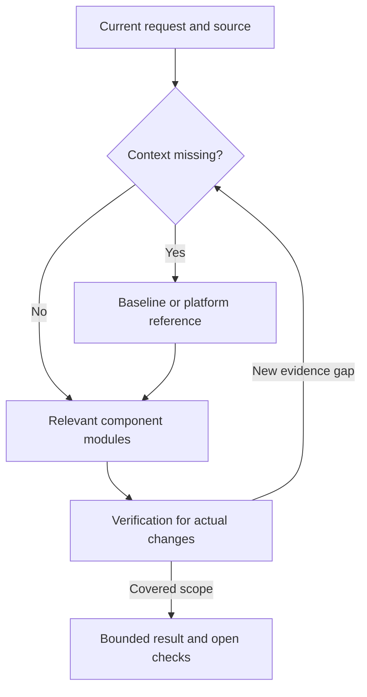

# Module routing relationships

This is a reading route, not a package dependency graph. No companion Skill is installed automatically.

Read normally 1–3 detailed references for the active gap. This is a budget guideline, not a hard cap: a genuine shared root cause may require another module. Do not recursively load every related reference. Baseline, platform and verification details already known need not be reread without a change. Liquid glass is a separate optional experiment gate in the entrypoint, not a default branch of component work.
